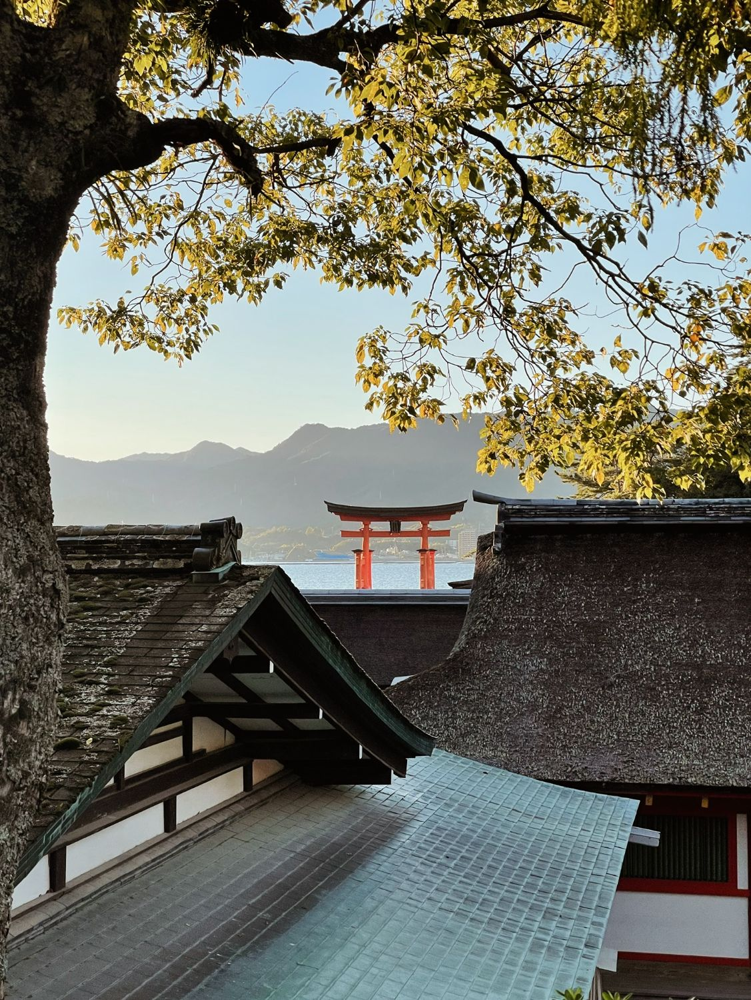

One of Japan's most photographed landmarks: the torii gate of Itsukushima Shrine. A fantastic day trip from Hiroshima! I can highly recommend trying the Momiji Manju (maple leaf cakes), the oysters, and the fried Momiji. But watch out for the deer! 🦌