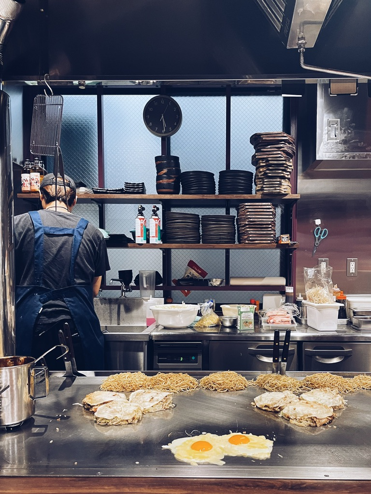

Okonomiyaki – a delicious Japanese savory pancake. Unlike in Osaka, the Hiroshima style uses noodles as the base. We had some really delicious ones at [Momiji-Tei](https://www.google.com/maps/search/?api=1&query=Momiji-Tei%2C+Japan%2C+%E3%80%92730-0031+Hiroshima%2C+Naka+Ward%2C+Kamiyacho%2C+2+Chome%E2%88%923%E2%88%9210+%E3%83%AA%E3%83%96%E3%83%AC%E7%B4%99%E5%B1%8B%E7%94%BA%E3%83%93%E3%83%AB302%E5%8F%B7), where they are prepared fresh right in front of you.
