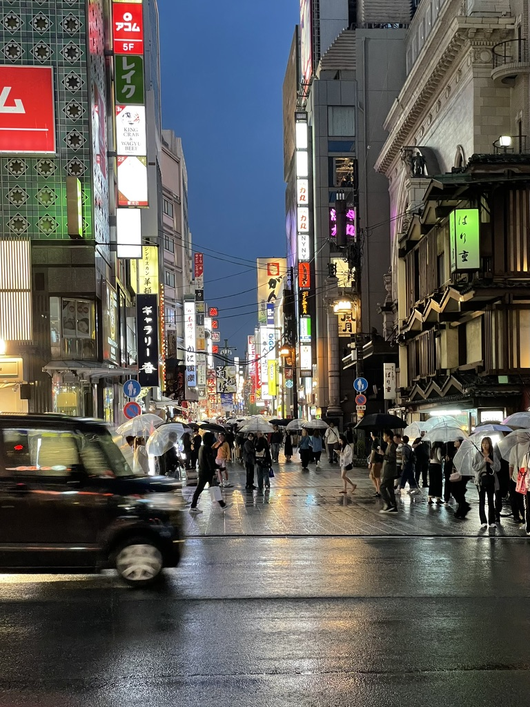

+++
title = 'Osaka'
date = 2026-10-04T07:00:00+01:00
draft = false
+++

Konnichiwa, Osaka! Osaka was the first stop on our trip to Japan. It is exactly how I always imagined Japan: colorful, vibrant, and a little crazy! The buildings are covered in wild neon signs, and sometimes even giant moving crabs (Kani Doraku). Between all the hip cafés, we also tried the local specialties, such as takoyaki (octopus balls) and okonomiyaki (Japanese pancake).

📍 Osaka, Japan
