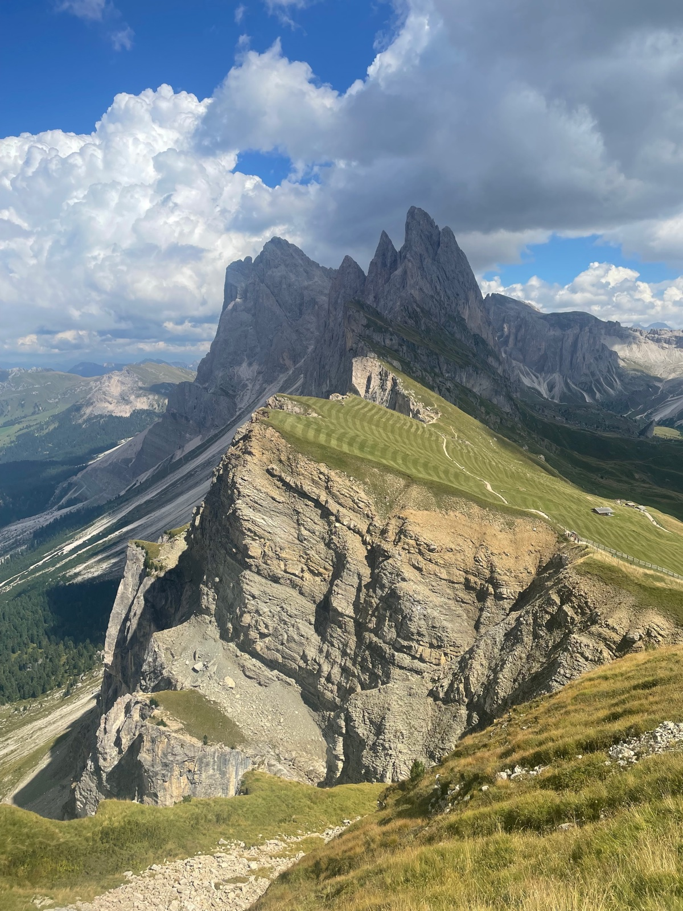

+++
title = 'Eine kurze Anleitung zum Wandern auf die Seceda-Alm'
date = 2026-09-23T07:00:00+01:00
draft = false
language = 'de'
+++

Die grüne Seceda-Alm mit ihrer schroffen Felskante ist wohl einer der schönsten Orte in den Dolomiten und eines der beliebtesten Fotomotive in Südtirol. Sie ist Teil des UNESCO-Welterbes Dolomiten. Auf 2.500 Metern Höhe bietet sich ein fantastischer Blick in alle Richtungen. Doch der Ort ist so beliebt, dass es in der Hauptsaison ziemlich schwierig sein kann, einen Parkplatz zu bekommen, um die Wanderung überhaupt zu starten.
Viele starten ihre Wanderung in St. Ulrich oder nehmen von dort die Seilbahn direkt zur Seceda. Ich habe dort allerdings vergeblich einen Parkplatz gesucht und bin daher eher zufällig in St. Christina gelandet. Dort gibt es sowohl im Ort als auch direkt an der Seilbahn Col Raiser viele Parkmöglichkeiten.

Von St. Christina dauert der Aufstieg zur Seceda-Alm etwa 3 bis 4 Stunden. Wer möchte, kann auch direkt die Seilbahn zur Col-Raiser-Alm nehmen. Der Preis für die Seilbahn liegt bei 37 Euro pro Person (2026) und ist damit deutlich günstiger als die Seilbahn in St. Ulrich.

Schon an der Bergstation startet die Wanderung mit einem wunderbaren Panoramablick, der einen bis zur Seceda begleitet. Auf dem Weg zum Gipfel gibt es außerdem zahlreiche Möglichkeiten, in einer der Hütten einzukehren und den Ausblick zu genießen.

Als Reaktion auf den großen Besucherandrang haben die Grundeigentümer eine Zahlstelle für einen schmalen Pfad entlang der Alm eingerichtet. Für 5 Euro kann man dort ebenfalls entlangwandern. Ich persönlich finde allerdings nicht, dass sich der Preis für das kurze Stück lohnt (siehe auch die Google-Rezensionen). Ein Schnappschuss vom Gipfelkreuz ist meiner Meinung nach ohnehin das schönere Erinnerungsfoto.

📍 Dolomiten, Italien   