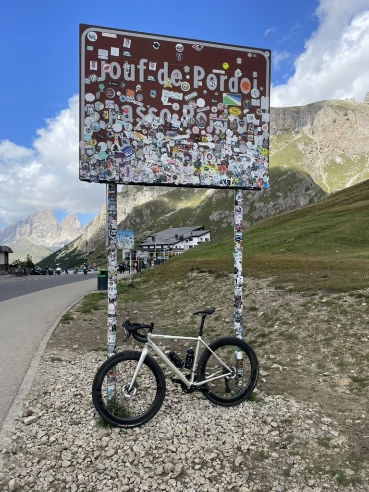
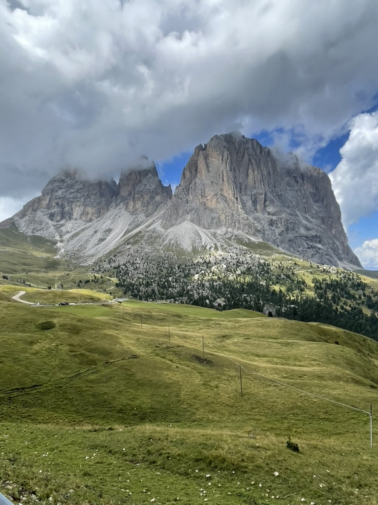
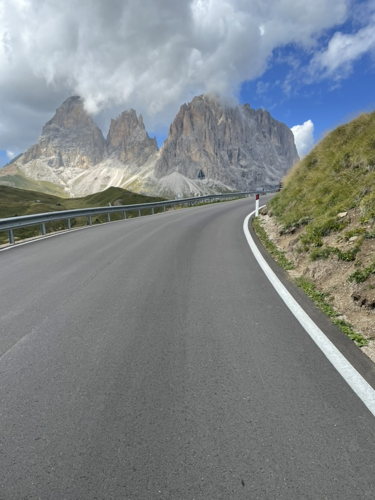

Sella Ronda – a spectacular cycling loop through the Dolomites. Perhaps one of the most beautiful bike rides you can do! Over approximately 50 km, you cross four mountain passes and climb around 1,800 metres in elevation. 🚴‍♂️⛰️

